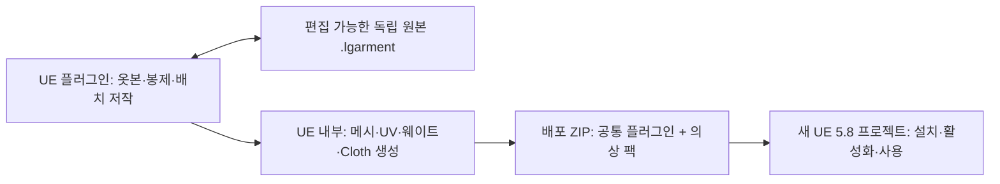

# UE 5.8 독립 의상 저작·배포 플러그인 설계

작성·개정일: 2026-10-16. 상태: **REQ-012에 따라 별도 대화의 구현 대상으로 승인됨**. 아래 기능의 구현 완료를 뜻하지 않습니다. 근거: [REQ-008~012](../REQUESTS.md). REQ-011에 따라 이전 Blender 애드온 필수 구조를 UE 에디터 단독 저작 구조로 대체했습니다. 가칭은 **LaceGarment**이며 제품명은 기술 식별자와 구분합니다.

REQ-012는 별개의 Astra / High 구현 대화를 생성하여 작업을 시작하라는 후속 요청입니다. 이 설계·관리 대화는 계속 계획과 검토를 담당하고, 기존 LaceLoft 게임 구현 대화에 플러그인 작업을 추가하지 않습니다. 독립 개발 호스트는 `PluginDev/LaceGarmentHost/`, 플러그인 상태 기록은 `Docs/Implementation/LaceGarment/STATUS.md`로 분리합니다.

**REQ-017의 현재 실행 범위:** 이번 구현 대화는 계획의 Task 1~3(독립 호스트·패널, 봉제·안정화·Cloth, 바디·대표 의상·문서 모델)만 완료 목표로 삼습니다. 아래 전체 설계 중 독립 원본 파일, 실제 저작 WBP/EUW, 콘텐츠 팩·배포·cook, 새 프로젝트 최종 인수는 후속 범위로 남깁니다. 전체 제품 목표는 보존하되 이 네 항목이나 전체 관문 A–F 통과를 이번 완료 조건으로 요구하지 않습니다.

## 1. 목적과 범위

제작자가 **UE 5.8 플러그인만으로 옷본을 만들고 편집하여 의상을 생성·착장·저장·배포**합니다. Blender 실행, Blender 애드온, 외부 천 시뮬레이터, 외부 서버는 제작과 수신 어느 쪽에서도 필수가 아닙니다. 수신자는 새 UE 5.8 프로젝트에 플러그인을 설치·활성화하면 준비된 의상을 쓰고, 포함된 저작 도구로 자신의 의상을 만들 수 있어야 합니다.

사용자가 확정한 사항:

- 저작 환경은 **UE 5.8 에디터 내부의 플러그인 작업창**입니다. 외부 저작툴 없이 기본 의상의 제작 전 과정을 완료해야 합니다.
- 원본 LaceLoft 프로젝트 없이 의상 파일을 보관·전달할 수 있어야 합니다.
- 배포 ZIP은 이메일, 클라우드, USB 등 파일을 전달할 수 있는 수단으로 배포합니다. 특정 서비스나 계정이 필수여서는 안 됩니다.
- 수신자가 새 UE 5.8 프로젝트에서 사용할 수 있어야 합니다.
- 실제 UMG 화면은 Designer에서 수정 가능한 WBP 애셋으로 제공합니다.

설계 선택:

- 독립 원본은 `.lgarment`, UE에서 바로 쓰는 결과물은 별도의 배포 `.zip`으로 구분합니다.
- `.lgarment`에는 다시 편집 가능한 옷본·봉제·배치 원본을 저장합니다. 준비된 3D 메시만 제공하는 변환 도구로 범위를 축소하지 않습니다.
- 첫 버전은 기준 인형과 티셔츠·돌핀쇼츠 템플릿, 빈 옷본 조각 만들기를 제공합니다. 범용 조형·리깅 프로그램 전체를 만들지는 않습니다.
- 네이티브 플러그인 코드는 Editor 모듈에 모으고, 게임에서 필요한 공통 데이터와 사용 예시는 엔진 클래스 기반 Blueprint 애셋으로 제공합니다.
- 최초 검증 의상은 기존 요구사항인 반팔 티셔츠와 돌핀쇼츠, 기준 바디는 OB11 비율의 흰 더미 인형입니다.
- 첫 릴리스는 설치된 Epic UE **5.8.3 / Win64**를 검증 기준으로 삼습니다. 지원하는 다른 5.8 빌드는 호환성 표에 추가합니다.

## 2. 전달물과 전체 흐름



| 전달물 | 포함 내용 | 주 사용자 |
| --- | --- | --- |
| UE 저작 플러그인 ZIP | 선컴파일 저작 도구, 실제 WBP 작업창, 기준 인형, 옷본 템플릿 | 제작자 |
| `.lgarment` | 편집 원본 JSON, 생성 결과 GLB, PNG 텍스처, 기준 인형, 출처·이용조건 | 제작자 간 교환·재편집·보관 |
| UE 배포 ZIP | 선컴파일 Editor 도구, 공통 Blueprint 콘텐츠, 준비된 의상 콘텐츠 팩, 설치 안내 | 수신자 |

`.lgarment`만 전달받은 경우에는 UE 작업창에서 열어 애셋을 생성합니다. **플러그인 활성화 후 바로 의상 사용**하는 약속은 준비된 UE 배포 ZIP을 기준으로 검증합니다. 저작 도구만 설치해도 새 의상을 시작할 수 있고, 완성 의상 팩은 선택적으로 추가합니다. 모든 흐름에서 Blender나 원본 LaceLoft 프로젝트가 필요하지 않습니다.

검토한 대안:

| 방식 | 판단 |
| --- | --- |
| Blender 애드온 + UE 변환기 | 이전 설계. 외부 DCC를 필수로 하므로 REQ-011에 따라 대체 |
| UE에서 기존 완성 메시만 가져오기 | 원본 의상을 외부에서 만들어야 하므로 독립 저작 요구를 충족하지 못함 |
| UE 의상 저작 도구 + 독립 원본 + 플러그인 ZIP | 저작·재편집·배포가 UE 안에서 완결되어 채택 |

## 3. 사용자 흐름

### 제작자: UE 안에서 새 의상 저작

1. **새 의상**에서 티셔츠·돌핀쇼츠 템플릿 또는 빈 옷본으로 시작하고 포함된 OB11 바디를 선택합니다.
2. 2D 옷본 뷰에서 점·직선·곡선 제어점, 조각 크기·대칭·시접·결 방향을 편집합니다. 새 조각을 만들거나 복제하고, 목·허리·밑단처럼 연결하지 않을 경계를 지정합니다.
3. 봉제할 경계와 구간, 방향, 여유 길이를 짝지어 지정합니다. 이 작업은 완성 옷의 연결 구조를 저작하는 기능입니다.
4. 3D 인형 주변에 조각을 배치합니다. 템플릿에는 초기 배치 가이드를 제공하고, 사용자가 위치·회전·몸 주변 휘어짐을 조절할 수 있게 합니다.
5. **의상 생성/맞춤 미리보기**에서 삼각형 메시, 봉제 연결, UV, 천 속성을 생성하고 인형에 맞춰 시뮬레이션합니다. 수렴하지 않거나 충돌·뒤집힘이 발생하면 부위를 표시하고 배치·봉제를 수정합니다.
6. 원단 색·PBR 값과 포함 원단을 선택하고 필요하면 텍스처 이미지를 가져옵니다. 바디의 스킨 웨이트 전송 결과와 천 고정/가동 영역을 확인·보정한 뒤 기본 포즈로 검수합니다.
7. **의상 파일 저장**으로 편집 원본을 보존합니다. 미완성 작업은 초안으로 저장할 수 있고, 완성 검사를 통과한 작업만 배포합니다. 새 프로젝트에서 이 파일을 다시 열어 옷본과 봉제를 계속 수정할 수 있어야 합니다.

제작자가 편집하는 옷본 원본과 게임 사용자가 따라 자르는 선은 같은 데이터를 공유할 수 있지만, 저작 편집과 게임 진행은 별개입니다. 기존 게임의 지정선 재단·봉제 체험을 자유 모델링 기능으로 바꾸지 않습니다.

### 제작자: UE 배포 준비

1. LaceGarment 작업창에서 현재 의상 문서 또는 받은 `.lgarment`를 엽니다.
2. 형식·버전·해시·바디·단위 검사 후 가져올 옷과 팩 이름을 확인합니다.
3. 팩의 불변 ID를 할당하고 최종 플러그인 경로를 먼저 만듭니다. 새 플러그인 인식에 재시작이 필요한 경우 작업을 저장하고 재시작 후 가져오기를 이어갑니다.
4. 그 경로에 Skeleton, Skeletal Mesh, Physics Asset, 재질·텍스처, Cloth Asset, 의상 정의를 생성합니다.
5. 제공 인형에서 착장·기본 포즈·천 충돌을 확인합니다. 편집기에서 Cloth와 Dataflow 결과물을 빌드해 저장합니다.
6. 배포 검사를 통과하면 **배포 ZIP 만들기**로 지정한 UE 버전용 도구와 콘텐츠 팩을 묶습니다.

새 의상마다 C++ 플러그인을 컴파일하는 방식은 피합니다. 배포 도구는 검증된 공통 바이너리를 재사용하고, 콘텐츠 팩만 새로 만듭니다. 공통 도구 릴리스의 컴파일은 플러그인 개발·릴리스 환경에서 수행합니다.

### 수신자: 새 UE 프로젝트

1. 프로젝트를 닫고 배포 ZIP의 `Plugins` 폴더를 프로젝트 루트에 넣습니다.
2. 프로젝트를 열고 배포 안내에 표시된 의상 팩을 활성화합니다. 팩이 선언한 공통 플러그인·엔진 플러그인 의존성도 함께 활성화합니다. 필요한 경우 재시작합니다.
3. **LaceGarment 의상 라이브러리**에서 의상을 선택하거나 **새 의상**으로 저작을 시작합니다.
4. 포함된 흰 더미 인형으로 미리보기·기본 포즈·천 시뮬레이션을 확인하거나, 제공 Actor Blueprint를 레벨에 배치합니다.
5. 같은 바디 프로필을 사용하는 자신의 인형에 의상을 연결합니다. 다른 체형은 제작 단계에서 맞춤 작업이 필요합니다.

기존 의상의 **원본 편집**은 배포 팩에 포함된 `.lgarment`를 작업 문서로 엽니다. 수정 결과는 초안으로 저장한 뒤 재생성·검증을 거쳐 새 버전 또는 새 의상으로 배포합니다. 생성된 `.uasset`만으로 옷본 원본을 역추론하지 않습니다.

플러그인을 활성화하는 것만으로 호스트 프로젝트의 GameMode, 기본 맵, 입력 설정을 바꾸지 않습니다. 기존 캐릭터에 대한 자동 착장은 바디·골격 호환성이 확인된 경우에만 제공합니다.

## 4. 구성과 책임

| 구성 | 책임 | 허용 의존성 |
| --- | --- | --- |
| UE 공통 플러그인 `LaceGarment` | 독립 저작·검증·저장·배포, 라이브러리 화면, 공통 데이터 Blueprint | UE 엔진·명시된 기본 플러그인 |
| Editor 저작 문서 모델 | 옷본 제어점·봉제·배치・원단・Undo/Redo・초안 저장의 단일 원본 | 플러그인 자체 데이터 계약 |
| Editor 생성 파이프라인 | 2D 샘플링·삼각분할, 봉제 대응, UV, 렌더/시뮬레이션 메시, 드레이핑, 웨이트·Cloth 빌드 | UE Geometry·Chaos Cloth·Dataflow 관련 기능 |
| 네이티브 `LaceGarmentEditor` 모듈 | 저작 작업 처리, 파일 입출력, 애셋 빌드, 경로·의존성 검사, 메뉴/명령 등록 | Editor 전용 API |
| 공통 런타임 콘텐츠 | 엔진 `PrimaryDataAsset` 기반 정의 Blueprint, 구조체·열거형, 사용 예시 | 엔진 런타임 클래스, 포함된 공통 콘텐츠 |
| `LGPack_<불변ID>` | 의상 정의, 형상, 재질, 바디, 충돌, 포즈, Cloth 결과물 | 자기 팩, 공통 콘텐츠, 선언된 엔진 의존성 |
| LaceLoft 연결부 | 독립 의상 정의를 게임의 제작 진행·장착 규칙에 연결 | 게임 → 플러그인 방향만 허용 |

v1은 사용자 정의 C++ Runtime 모듈을 두지 않는 설계입니다. 의상 정의의 Blueprint 부모와 구조체도 공통 플러그인의 **런타임 콘텐츠**에 저장하며, Editor 클래스나 LaceLoft 클래스를 상속하지 않습니다. 구조화된 런타임 데이터를 게임에서 읽을 수 있는 Blueprint 접근 함수를 제공합니다.

Cloth Asset은 UE의 기본 Chaos Cloth 런타임을 이용합니다. 옷본 저작, 메시 생성, Dataflow 빌드, 검사 UI는 Editor 쪽에 남습니다. 엔진 기본 플러그인 의존성도 descriptor에 명시하고 cook/패키지 시험에서 확인합니다. 필요한 기능이 이 경계에서 구현되지 않으면 구현자가 증거를 기록하고 설계를 수정한 뒤 범위를 확정합니다.

### 4.1 UE 안에서 직접 만들어야 하는 기능

UE의 메시 처리와 Cloth/Dataflow는 기반 기능입니다. 플러그인은 다음 저작 기능을 직접 연결·구현해야 합니다. Geometry Scripting에 메시 생성·UV·스킨 데이터 처리 기능이 있다는 사실만으로 의상 저작 전체가 완성되는 것은 아닙니다. [Epic Geometry Scripting 안내](https://dev.epicgames.com/documentation/unreal-engine/introduction-to-geometry-scripting-in-unreal-engine)

| 단계 | 플러그인이 보장할 동작 |
| --- | --- |
| 옷본 원본 | 제어점·곡선·대칭·치수와 안정 ID를 저장. 삼각형 메시를 편집 원본으로 삼지 않음 |
| 메시 생성 | 옷본 유효성 검사 후 경계를 샘플링하고 내부를 삼각분할. 봉제 양쪽의 방향·notch·길이 비율에 맞춰 대응 생성 |
| 초기 3D 배치 | 조각별 변환·휘어짐·고정 가이드 저장. 인형과 심하게 겹치는 초기 배치를 검출 |
| 봉제·맞춤 | 명시한 seam을 Cloth 데이터의 연결로 변환하고 단계적으로 안정화. 단순 정점 합치기를 자동 봉제·피팅 완료로 보고하지 않음 |
| 생성 결과 확정 | 안정된 3D 결과를 미리보기/바인딩 기준으로 취하고 2D rest 옷본은 보존. 이후 런타임에 사용할 Cloth를 별도로 검증 |
| 렌더·UV | v1은 시뮬레이션 표면에서 렌더 메시를 생성. 옷본 좌표로 UV 섬을 만들고 실제 크기에 따른 밀도·padding·겹침을 검사하며 패킹. 전체 2D bounds를 0..1로 정규화하는 것만으로 완료 처리하지 않음 |
| 스킨·포즈 | 기준 바디에서 웨이트를 전송한 후 관절·가랑이·소매의 잘못된 전송을 검사하고 UE 안에서 보정 |
| 재생성 | 옷본·봉제·바디 변경 시 파생 메시·UV·웨이트·Cloth를 무효화. 낡은 결과를 현재 문서의 완성본으로 배포하지 않음 |

v1의 지원 범위는 티셔츠와 돌핀쇼츠를 새로 만들고 수정해 배포할 수 있는 의상 전용 도구입니다. 복잡한 다층 의복·모든 재단법·범용 스컬프팅·임의 체형 자동 리깅까지 보장하지 않습니다. 새 옷본을 만들 수 있지만 유효한 경계·지원 봉제 방식·기준 바디 조건을 만족해야 합니다.

UE 5.8의 현재 Cloth/Dataflow 구조를 기준으로 사용 API를 확인하고, 예전 Panel Cloth 편집기를 필수 화면으로 고정하지 않습니다. 자체 작업창이 저작 입력을 담당하고 엔진의 데이터·빌드 기능을 호출합니다.

대표 의상은 인형의 실제 크기에서 충돌 두께·삼각형 간격·타임스텝·수렴을 확인합니다. OB11은 비율 기준이며 특정 상품의 실측 크기로 단정하지 않습니다. 기존 제안 치수는 [바디 설계](LACELOFT_DESIGN.md)를 따르고 최종 바디에서 측정합니다. 엔진 편집기용 Cloth 기본 재질 대신 포함된 배포용 재질을 명시적으로 지정합니다.

## 5. 파일과 플러그인 경로

```text
LaceGarment_<release>_UE5.8.3_Win64.zip
  INSTALL_KO.md
  distribution.json
  LICENSES/
  Plugins/
    LaceGarment/
      LaceGarment.uplugin
      Binaries/Win64/
      Content/Runtime/              # 공통 데이터·예시 Blueprint
      Content/UI/Editor/            # 작업창 WBP/EUW, 런타임 참조 금지
      Content/Authoring/            # 기준 바디·옷본 템플릿·원단
      Resources/
      Source/ 및 필요한 빌드 산출물  # 검증된 패키징 결과를 보존
    LGPack_<uuid32>/
      LGPack_<uuid32>.uplugin
      Content/
        Definitions/
        Garments/
        Body/
        Materials/
        Preview/
      Resources/pack.json
      Resources/Sources/<garmentId>.lgarment  # 재편집 가능한 검증 원본
```

공통 플러그인과 의상 팩은 형제 폴더입니다. 팩은 `Modules`가 없는 콘텐츠 플러그인이고 `CanContainContent`를 활성화합니다. 의상 표시 이름은 바꿀 수 있지만 플러그인 ID와 마운트 경로는 바꾸지 않습니다. UE가 플러그인 검색 경로와 콘텐츠 포함을 지원하는 방식에 맞춘 구조입니다. [Epic 플러그인 문서](https://dev.epicgames.com/documentation/unreal-engine/plugins-in-unreal-engine)

UE 콘텐츠는 **uncooked 원본 애셋**을 전달합니다. 수신자가 게임을 패키징할 때 대상 플랫폼용으로 cook합니다. 다운로드한 옷을 이미 출시된 실행 파일에 동적으로 설치하는 모드 시스템은 v1 범위에 포함하지 않습니다.

배포 팩은 의상별 검증된 `.lgarment`를 기본 포함하고 `pack.json`에서 상대경로·버전·해시로 연결합니다. 공통 도구가 파일을 열어 수정할 수 있으므로 배포 후에도 독립 저작이 이어집니다. 이 저작 원본은 게임 런타임의 필수 리소스가 아니며 게임 패키지에 자동 포함하지 않습니다.

## 6. 프로젝트 의존성 제거

독립성은 파일 개수보다 참조 관계로 판정합니다.

- 의상·Blueprint·기본값에서 시작해 hard/soft package 참조, 부모 클래스·인터페이스·구조체·함수 노드의 모듈 의존성을 확인합니다.
- 허용 경로는 자기 `/<LGPack_ID>/`, `/LaceGarment/`, 필요한 `/Engine/` 및 명시한 엔진 플러그인입니다. 네이티브 모듈은 해당 환경에서 제공되는 엔진 모듈만 허용합니다.
- `/Game/`, `/Script/LaceLoft`, 다른 의상 팩, 미포함 파일, 미선언 플러그인 참조는 배포 실패입니다.
- 런타임 콘텐츠가 `/Script/LaceGarmentEditor`나 Editor 전용 애셋을 참조하면 실패합니다.
- 문자열로 조합해 외부 애셋을 로드하는 관행은 금지합니다. 허용된 soft reference 필드와 등록된 의상 정의를 통해서만 로드합니다.
- 최종 팩 경로에서 애셋을 생성합니다. 기존 애셋을 수용할 때는 UE의 지원되는 복제·참조 수정·저장 과정과 재검사를 사용합니다. 파일 탐색기 복사나 폴더명 변경으로 참조가 바뀐다고 가정하지 않습니다.
- redirector를 정리하고, 임포트 메타데이터의 제작자 절대경로는 제거하거나 포함 원본에 대한 상대 식별자로 바꿉니다.
- 미리보기용 바디·골격·Physics Asset·포즈도 팩에 포함합니다. 같은 팩 안에서는 중복을 줄일 수 있지만 다른 의상 팩을 요구하지 않습니다.
- 각 팩의 `DA_LaceGarmentCatalog`는 모든 런타임 의상 정의·변형·미리보기 Actor를 명시적으로 참조합니다. `LaceGarmentEditor`는 **cook commandlet에서도 로드되는 Editor 모듈**로 선언하고, Asset Manager 초기화 후 활성 팩의 카탈로그 경로와 실제 Primary Asset Type을 등록·스캔하여 각 카탈로그에 재귀적인 `AlwaysCook` 규칙을 적용합니다. GUI 작업창을 열어야만 이 등록이 실행되는 구조는 금지합니다.
- cook 등록은 현재 프로세스의 Asset Manager API로 수행하며 호스트의 전체 Asset Manager 설정을 교체하지 않습니다. 카탈로그가 적용된 cook 결과에 모든 런타임 의상·변형이 들어있는지 확인합니다. 기본 `/Game` 검색이나 팩에 Label 파일을 두는 것만으로 포함된다고 가정하지 않습니다.
- `Content/UI/Editor/`의 WBP/EUW와 도구 전용 애셋은 카탈로그에서 제외하고, cook commandlet의 제외 목록에 명시적으로 등록합니다. 경로 이름 자체를 제외 근거로 삼지 않습니다. cook 결과에 Editor UI와 Editor 모듈 의존이 남으면 실패입니다. 상충하는 호스트 cook 규칙이 있으면 누락된 자산과 규칙을 보고합니다.

Asset Registry 검사만으로 임의 파일 접근까지 증명하지 않습니다. 마지막 검증은 원본 프로젝트에 접근할 수 없는 깨끗한 프로젝트에서 전체 의상 로드와 실행입니다. [Epic 참조 방식](https://dev.epicgames.com/documentation/unreal-engine/referencing-assets-in-unreal-engine), [cook 규칙](https://dev.epicgames.com/documentation/en-us/unreal-engine/cooking-content-and-creating-chunks-in-unreal-engine)

## 7. 화면과 편집 가능성

UE 화면은 공통 플러그인의 `Content/UI/Editor/`에 `EUW_LaceGarmentWorkbench`, `WBP_GarmentLibrary`, `WBP_PatternEditor`, `WBP_SeamEditor`, `WBP_GarmentPreview`, `WBP_GarmentProperties`, `WBP_GarmentValidation`, `WBP_GarmentExport`를 실제 애셋으로 저장합니다. 명칭은 설계용이며 구현 시 확정합니다. 런타임 UI가 필요해지는 경우에도 실제 WBP를 `Content/UI/Runtime/`에 별도로 두고 Editor 작업창 참조를 금지합니다.

작업창은 왼쪽 조각·봉제 목록, 가운데 2D 옷본/3D 인형 보기, 오른쪽 치수·원단·물성, 아래 생성 상태·오류로 구성합니다. 상단에는 새 의상·열기·저장·Undo/Redo·맞춤 미리보기·애셋 생성·ZIP 내보내기를 둡니다. 검사 결과는 문제 부위와 수정할 항목을 보여줍니다.

C++은 데이터 제공, 저장된 WBP 인스턴스 표시, 입력 처리와 저작·생성 작업을 담당합니다. 메뉴 명령은 저장된 작업창을 엽니다. 위젯 계층·배치·스타일은 코드에서 조립하지 않습니다. 2D 뷰는 Designer에 배치한 뷰에서 옷본을 그리며, 3D 뷰는 미리보기 씬의 렌더 타깃을 Designer의 Image에 표시하고 입력을 전달하는 구조를 우선 사용합니다. 뷰의 위치·크기·스타일·예제 상태를 Designer에서 확인할 수 있어야 합니다. [UMG 제작 지침](../UMG_GUIDELINES.md)을 그대로 적용합니다.

## 8. 호환성·설치·업데이트

- 원본 형식 버전, 저작 도구 버전, UE 생성기 버전, 공통 플러그인 버전, 팩 버전을 분리합니다.
- Blender 설치 경로·Python 환경·외부 실행 파일을 탐색하거나 요구하지 않습니다. GLB는 독립 파일 내부의 교환 형식이며 Blender 실행을 뜻하지 않습니다. 원본 읽기·쓰기 모두 플러그인 안에서 수행합니다.
- 현재 로컬 UE는 5.8.3, CL 58210709, Win64 Editor BuildId 55116800입니다. 이 값은 조사 환경이며 아직 제품 검증 완료를 뜻하지 않습니다.
- 배포 manifest에는 검증한 UE 버전/빌드, OS·아키텍처, 필요한 엔진 플러그인, 공통 플러그인 범위를 기록합니다. BuildId를 수정해 호환성 검사를 우회하지 않습니다.
- `.lgarment`의 독립성은 특정 UE 바이너리의 다른 엔진 버전 호환성을 뜻하지 않습니다. 다른 5.8 패치·소스 빌드·OS는 실측 호환성 표로 지원합니다.
- 목표는 **수신자의 Editor 설치·옷본 저작·의상 생성·열기·미리보기·배치에 C++ 컴파일러가 필요 없는 배포본**입니다. 게임의 Development/Shipping 패키징은 별도 시험이며 UE의 일반적인 플랫폼 도구 요구사항까지 제거한다고 약속하지 않습니다.
- `BuildPlugin` 성공은 에셋 의존성 검사와 cook 성공을 대신하지 않습니다. 필요한 precompiled metadata를 포함한 도구 패키징 결과를 보존하고 `Intermediate`라는 이름만으로 무조건 삭제하지 않습니다.
- 처음 설치할 때는 한 ZIP으로 완료합니다. 여러 ZIP의 공통 플러그인 버전이 다르면 설치 안내와 manifest를 비교하여 검증된 호환 버전을 사용하고, 낮은 버전으로 덮어쓰지 않습니다.
- 업데이트는 Editor를 닫은 상태에서 기존 팩을 백업한 뒤 교체합니다. 같은 PackId는 같은 계열의 업데이트이며 서로 다른 버전을 동시에 설치하지 않습니다. 기존 애셋 경로를 보존합니다. 독립 파생본은 새 PackId를 발급합니다.

UE의 바이너리 호환성은 모듈 빌드 식별자와도 관련됩니다. 지원 판정은 버전 문자열만으로 끝내지 않습니다. [Epic 바이너리 버전 문서](https://dev.epicgames.com/documentation/unreal-engine/how-to-version-binaries-in-unreal-engine?lang=en-US)

## 9. 기존 LaceLoft 기능과의 연결

게임은 이 플러그인의 결과물을 읽는 소비자가 될 수 있습니다. 플러그인이 LaceLoft 게임을 요구해서는 안 됩니다. 현재 구현 중인 게임 모듈·세 레벨·저장 형식은 이번 설계로 변경하지 않습니다.

지정선 재단과 봉제는 독립 원본의 PieceId, EdgeId, SeamId를 이용할 수 있습니다. 완성 후에는 같은 옷본 버전에서 준비한 의상 결과물을 장착합니다. 게임의 재단·봉제 진행률, Undo, 소유 여부와 세이브는 원본 `.lgarment`에 저장하지 않습니다.

OB11 기준 바디는 기존 [인형·UV 설계](LACELOFT_DESIGN.md)의 고유 UV0, 도색 가능성, 치수·골격 기준을 지킵니다. 게임에서 만든 바디를 재사용하려면 독립 팩에 복제하고 프로젝트 참조·배포 조건을 검증합니다. 체형·골격 프로필이 다르면 자동으로 맞는다고 표시하지 않습니다.

## 10. 검증 순서와 완료 조건

아래는 설계의 검증 관문입니다. 상세 구현 작업 지시서나 현재 완료 상태가 아닙니다.

| 관문 | 증명할 내용 |
| --- | --- |
| A. UE 단독 저작 | Blender·외부 솔버·C++ 컴파일러 없는 새 Blank Blueprint 프로젝트에서 빈 조각과 템플릿을 만들고 경계·봉제를 수정해 실제 메시와 Cloth 생성. 티셔츠 소매·쇼츠 길이 변경이 출력에 반영되며 사전 완성 메시 교체로 대신하지 않음 |
| B. 원본 왕복 | UE 저작 → 독립 파일 저장 → 원본 프로젝트에 접근할 수 없는 다른 UE 프로젝트에서 열기 → 제어점·봉제 수정 → 재생성·저장 성공. 초안과 검증 완료 상태, 치수·UV·골격·재질 의미 보존 |
| C. 천과 포즈 | 실제 인형 크기의 티셔츠 겨드랑이·목과 쇼츠 가랑이·허리에서 관통·늘어남·뒤집힘·봉제 이탈·웨이트를 확인. 리셋·재시작 후 재현. 필요한 Cloth 결과가 패키지에서 로드·시뮬레이션되고 Editor 코드가 런타임에 들어가지 않음 |
| D. 배포 독립성 | hard/soft/클래스/외부 파일 검사 통과. 의도적으로 넣은 `/Game/`·게임 클래스·누락 텍스처 의존은 배포 전에 구체적인 오류로 차단 |
| E. 다중 팩·갱신 | 표시 이름이 같은 서로 다른 팩을 함께 사용. 같은 ID 충돌 감지. 업데이트 후 기존 배치·참조 유지 |
| F. 새 프로젝트 인수 | Blank Blueprint와 Blank C++ 프로젝트에서 설치·검색·배치·재시작. 라이브러리 창을 한 번도 열지 않은 새 프로젝트에서도 commandlet cook·Win64 Development/Shipping 실행 성공. soft reference 의상 누락과 Editor UI 혼입 없음. 실제 환경과 도구 요구사항 기록 |

관문 A에서 초기 배치→봉제 연결→안정된 형상→렌더 메시/UV/웨이트→Cloth 저장까지 먼저 검증합니다. 이 과정이 막히면 Blender로 넘기는 우회 경로를 완료로 처리하지 않고, UE 내부 생성 경로를 보완하거나 검증된 저작 범위를 명시합니다. 제공 인형의 골격과 UV는 배포 애셋으로 포함하므로 사용자가 직접 인형 모델링부터 할 필요는 없습니다.

실패 시 임시 생성물은 staging에 남기거나 정리하고 기존 설치 팩은 보존합니다. 검증 실패를 무시한 배포 성공 표시를 제공하지 않습니다. 미지원 필수 기능·재질·버전은 문제를 표시하고 변환을 중단합니다.

v1 제외: Blender 애드온과 외부 DCC 전용 연결, 범용 모델링·리깅 툴 전체, 임의 체형 자동 맞춤, 패키징된 게임 안에서의 자유 저작/새 Cloth 생성, 실행 파일용 온라인 모드 설치, 마켓·계정·결제·DRM·자동 업로드, 임의 셰이더 그래프의 완전 교환.

상세 원본 계약: [의상 파일 형식](LACE_GARMENT_PACKAGE_FORMAT.md).
